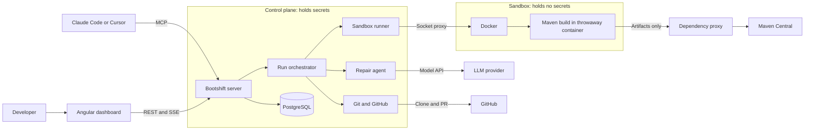
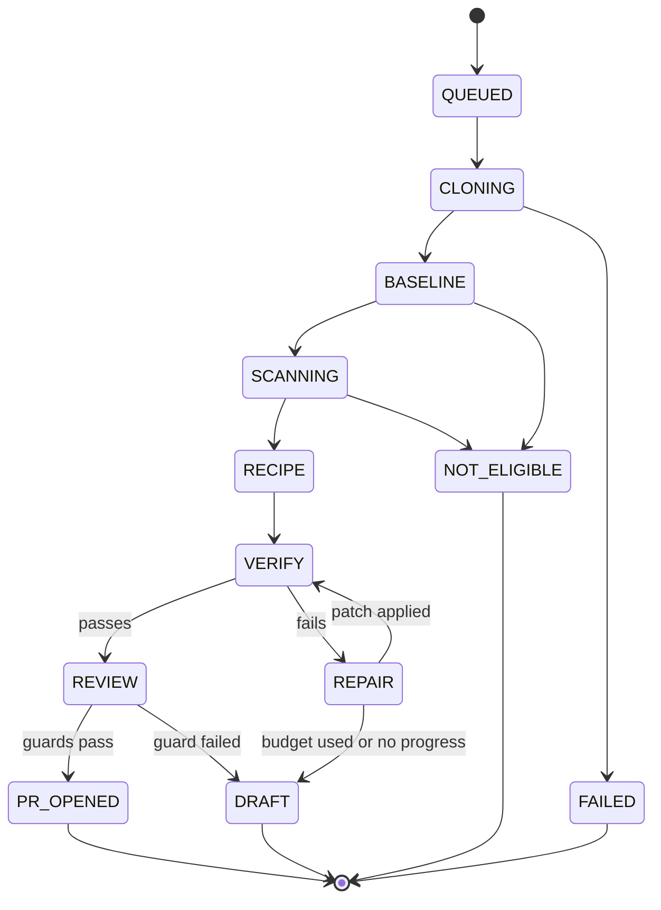
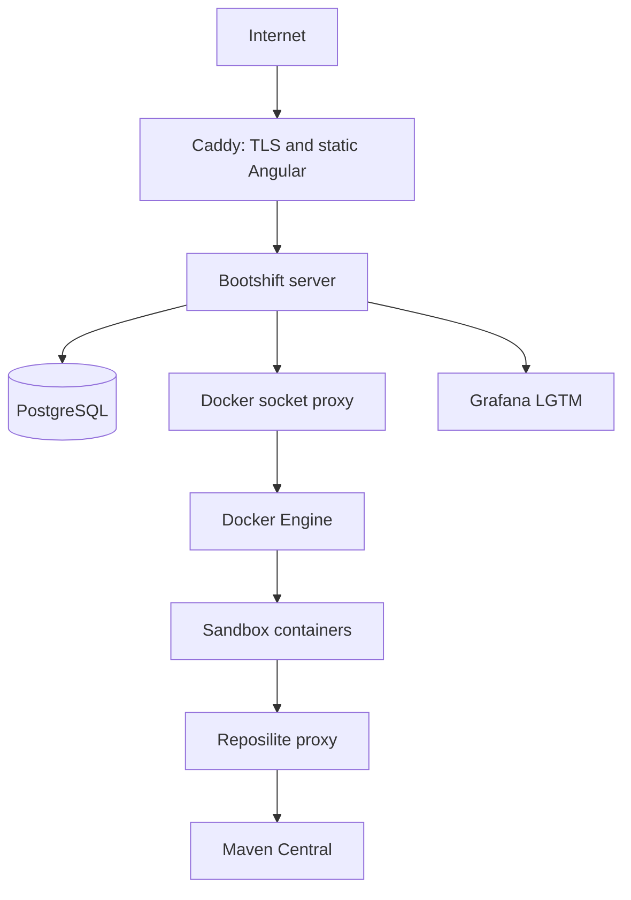

# Bootshift

**A self-hosted AI agent that upgrades Spring Boot 3 projects to Spring Boot 4 and opens a pull request only after checking the result.**

You point Bootshift at a Maven repo. It records how the project behaves today, runs the OpenRewrite recipes, uses an AI agent to fix what still fails, and opens a PR that explains every change.

> **Status:** Phases 1 and 2 done. Bootshift has a server, a live dashboard, a one-click
> **Connect GitHub** button and a repository allowlist. It clones a repository and runs
> its **baseline build in a locked-down sandbox container**, then records test results and
> fingerprinted failures. Scanning, recipes, the repair agent and pull requests are **not built
> yet**: those stages are simulated and labelled `[simulated]`. Update this section as phases ship,
> and never claim a feature or benchmark before it exists.
>
> | Phase | State |
> |---|---|
> | 0. Prove the idea | Mostly done ([`docs/phase-0.md`](docs/phase-0.md)); raw-model repair test open |
> | 1. Skeleton | Done |
> | 2. Sandbox and build | Done ([`docs/phase-2.md`](docs/phase-2.md)) |
> | 5. Pull requests | Connect GitHub (app manifest flow) and allowlist pulled forward; no pushes or PRs yet |
> | 6. Dashboard | Largely pulled forward; no login yet |
> | 3, 4, 7–11 | Not started |

---

## Contents

1. [Why this exists](#1-why-this-exists)
2. [Scope](#2-scope)
3. [License constraint](#3-license-constraint-read-first)
4. [Tech stack](#4-tech-stack)
5. [Architecture](#5-architecture)
6. [The migration pipeline](#6-the-migration-pipeline)
7. [The repair agent](#7-the-repair-agent)
8. [Migration playbook](#8-migration-playbook)
9. [Data model](#9-data-model)
10. [REST API](#10-rest-api)
11. [MCP server](#11-mcp-server)
12. [Angular dashboard](#12-angular-dashboard)
13. [Security](#13-security)
14. [Testing and evals](#14-testing-and-evals)
15. [Observability](#15-observability)
16. [Production deployment](#16-production-deployment)
17. [Repository layout](#17-repository-layout)
18. [Configuration](#18-configuration)
19. [Build plan](#19-build-plan)
20. [Working with Claude Code](#20-working-with-claude-code)
21. [Launch checklist](#21-launch-checklist)
22. [References](#22-references)

---

## 1. Why this exists

Open-source support for Spring Boot 3.5 ended on June 30, 2026, so teams still on 3.x have no free patches. The upgrade has no single sweeping change like `javax` to `jakarta`. It is many small breaks across starters, packages, test support, Spring Security 7 and Jackson 3.

OpenRewrite automates much of this, but real projects usually still have errors afterwards. Those last errors are slow to fix by hand, and they are where an AI agent can help.

**The rule that defines the product:** recipes first, AI second, verification always.

| Tool | What it does | What Bootshift adds |
|---|---|---|
| OpenRewrite | Deterministic code transformations | Fixes the failures left after the recipes run, then verifies the build |
| General coding agents | Can attempt an upgrade if you supervise them | A baseline, guardrails, a sandbox, budgets and a repeatable pipeline |
| Commercial upgrade platforms | Enterprise-scale migration | A small self-hosted tool you can read and run yourself |

## 2. Scope

### Version 1 includes

- Maven projects, single-module and multi-module
- Java projects on Spring Boot 3.5.x, moving to Spring Boot 4.1.x
- GitHub repositories
- A sandboxed build for every run
- An agent repair loop with hard budgets
- A PR, or a draft PR when the agent cannot finish
- An Angular dashboard with live progress
- An MCP server so Claude Code and Cursor can start and track runs
- A public eval suite with published results

### Version 1 excludes

Gradle, Kotlin, GitLab or Bitbucket, auto-merge, a hosted public service, multi-tenancy, billing, and upgrades other than the one above.

Boot 3.0–3.4 repos may run as **experimental**. Projects below Java 17 are rejected with a clear message.

### Definition of success

A run succeeds only when **all** of these are true:

- The project compiles.
- No test fails that passed at baseline.
- The number of executed tests has not dropped.
- No tests were deleted or newly disabled.
- No CI workflow, build repository or forbidden plugin was changed.
- Tests that could not run are named in the report, not hidden.

## 3. License constraint (read first)

The Spring Boot recipes in `rewrite-spring` use the **Moderne Source Available License**. The OpenRewrite licensing docs say this software may not be commercialized or provided to others as a managed service. Organizations may apply the recipes to their own code.

This shapes the design:

- **Bootshift is self-hosted.** Each user runs it on their own infrastructure, against their own code.
- **Never bundle the recipes.** The Maven plugin resolves them at run time inside the user's sandbox.
- **Do not run a public "paste your repo URL" site.** The public demo is a recorded video and a report of runs on repos we control.
- **Do not sell it** without first asking a lawyer or Moderne. This may also apply to paid installs and support.
- **Keep the recipe step behind a `RecipeEngine` interface** so it can be replaced later.
- **Bootshift's own code is Apache 2.0.** The README must state clearly that recipes have separate license terms.

This section is an engineering reading of the license, not legal advice.

## 4. Tech stack

| Layer | Choice | Reason |
|---|---|---|
| Runtime | Java 25 (LTS) | Avoids a short-lived release. No preview features |
| Backend | Spring Boot 4.1.x | Current stable line. Revisit when Spring AI documents 4.2 support |
| AI | Spring AI 2.0.x | Advisor-based tool loop, MCP support, structured output |
| Model | Google Gemini by default, xAI Grok as the second provider, configurable | Provider and model set through config, never hardcoded. Gemini uses `spring-ai-starter-model-google-genai` (Gemini Developer API key). Grok has no dedicated Spring AI starter, so it uses `spring-ai-starter-model-openai` pointed at xAI's OpenAI-compatible API. Evals compare both |
| MCP | `spring-ai-starter-mcp-server-webmvc` | `@McpTool` over Streamable HTTP |
| Frontend | Angular 22 | Stable Signal Forms, `httpResource`, OnPush by default |
| Database | PostgreSQL + Flyway | Stores runs and also acts as the job queue |
| Git | JGit | No git binary needed in the control plane |
| Sandbox | Docker via `docker-java` | Isolated build per run |
| Dependency proxy | Reposilite (or Nexus) | The sandbox reaches Maven artifacts only through this |
| Observability | OpenTelemetry + Grafana LGTM | Traces and metrics for every stage |
| Deployment | Docker Compose + Caddy | One VPS is enough. Kubernetes is a stretch goal |

**Deliberately left out:** Kafka, Redis and microservices. One Spring Boot app with Postgres handles this workload. Say that in interviews, because knowing what not to add is the point.

### Where each new feature is used

Only use a feature where it solves a real problem here.

| Feature | Use in Bootshift |
|---|---|
| Virtual threads | Workers block on Docker, Git and LLM calls without a large thread pool |
| API versioning | `/api/v1/...` through Spring's first-class versioning support |
| HTTP interface clients (`@HttpExchange`, `@ImportHttpServices`) | GitHub API client |
| `@Retryable` and `@ConcurrencyLimit` | Retries for GitHub and model calls, plus a limit on concurrent LLM calls |
| JSpecify `@NullMarked` | Null safety across all packages |
| `InetAddressFilter` | SSRF protection for configurable outbound URLs such as a GitHub Enterprise host |
| `LazyConnectionDataSourceProxy` | No database connection held during long LLM calls |
| OpenTelemetry starter | One trace per migration run |
| `RestTestClient` | API tests |
| Jackson 3 | Default serialization. No Jackson 2 compatibility shim |
| `ToolCallingAdvisor` | Agent tool loop |
| `StructuredOutputValidationAdvisor` | Self-correcting JSON for the final report |
| `@McpTool`, `McpSyncRequestContext` | MCP tools with progress reporting |
| Signal Forms | New-run form |
| `httpResource` | Dashboard reads |
| Angular Aria | Accessible tabs, dialogs and menus |

## 5. Architecture



### The most important boundary

**A build runs untrusted code.** Maven plugins and tests can execute anything. The design therefore splits into two zones:

| | Control plane | Sandbox |
|---|---|---|
| Runs | Bootshift | The target project's build and tests |
| Holds secrets | Yes: GitHub and model keys | Never |
| Network | GitHub, model provider | Dependency proxy only |
| Repo files | Treated as untrusted data | Mounted working copy |

The sandbox never calls the model and never pushes to Git.

### Backend modules

Package by feature, and enforce the boundaries with ArchUnit tests.

```text
dev.bootshift
├── run         run lifecycle, state machine, queue, events
├── repo        allowlist, repo access, Git operations
├── github      GitHub App auth, branches, pull requests
├── sandbox     container lifecycle, limits, log capture
├── build       Maven runner, Surefire parsing, failure fingerprints
├── scan        project detection, risk scan
├── recipe      RecipeEngine interface, OpenRewrite implementation
├── agent       ChatClient setup, tools, budgets, guardrails, prompts
├── playbook    migration knowledge
├── report      change summary, PR body
├── mcp         @McpTool endpoints
├── web         REST controllers, SSE
└── security    login, API keys, authorization
```

### Key decisions

| Decision | Choice | Why |
|---|---|---|
| Queue | Postgres with `FOR UPDATE SKIP LOCKED` | Durable, simple, no extra service |
| Live updates | Server-Sent Events | One-way stream is enough, and replay is easy from the event table |
| Recovery | Runs are resumable by stage | A restart marks in-flight stages as retryable |
| Agent memory | Fresh context each iteration, plus a short summary | Cheaper and less likely to drift than one long chat |
| File edits | Exact-match patch tool, in the control plane | Auditable, with no shell access for the model |
| Logs | Files on a volume, with metadata in Postgres | Build logs are too large for table rows |

## 6. The migration pipeline



### Stage by stage

**1. Clone.** The control plane clones with a short-lived token, creates the branch `bootshift/spring-boot-4`, and removes the credentials from the working copy before any container sees it.

**2. Baseline.** Run the unmodified project with `mvn -B verify`. Store the JDK used, the test results and a fingerprint of each failure. Without this step, Bootshift could not tell old failures from new ones. If the baseline does not compile, the run stops as `NOT_ELIGIBLE`. Existing test failures are allowed, recorded and shown in the report.

**3. Scan.** Detect the Boot and Java versions, modules, starters, and Docker-based tests. Flag known risks and estimate difficulty, then reject unsupported projects with a reason.

**4. Recipe.** Run OpenRewrite with pinned versions. Do not use `RELEASE` or `latest`, because results must be reproducible.

```bash
mvn -B -U org.openrewrite.maven:rewrite-maven-plugin:${REWRITE_PLUGIN_VERSION}:runNoFork \
  -Drewrite.recipeArtifactCoordinates=org.openrewrite.recipe:rewrite-spring:${REWRITE_SPRING_VERSION} \
  -Drewrite.activeRecipes=org.openrewrite.java.spring.boot4.UpgradeSpringBoot_4_0 \
  -Drewrite.exportDatatables=true
```

Use `runNoFork`, not `run`. The `run` goal compiles the project first, so a second recipe step fails as soon as the first one leaves code that does not compile (seen in Phase 0 on `security-chain`).

Then move to the 4.1 target with Bootshift's own `dev.bootshift.UpgradeSpringBoot_4_1` ([`recipe/bootshift-boot-4-1.yml`](recipe/bootshift-boot-4-1.yml)). It chains `SpringBootProperties_4_1` with parent, BOM, plugin and starter bumps to a pinned 4.1 patch. Phase 0 confirmed that rewrite-spring 6.37.1 has **no** community 4.1 umbrella recipe. The file only references recipes resolved at run time and bundles none. Commit each recipe step as its own commit, so reviewers can separate recipe work from agent work. The recipe may also make unrelated cleanups such as text blocks; the report must mention them.

**5. Verify.** Run the build again, and compare against the baseline.

**6. Repair.** Only if verification fails. See [section 7](#7-the-repair-agent).

**7. Review guards.** Inspect the final diff with deterministic code, not the model.

**8. Open the PR.** Push the branch and open a PR. If the build is still failing or a guard tripped, open a **draft** PR that lists what remains. Partial progress is still useful, and Bootshift never merges anything.

### Green is not the same as safe

Some Boot 4 changes pass the build and still change behavior. For example, Jackson 3 changes the default date output from timestamps to ISO strings, Spring 7 changes when validation is activated, and Jackson 3 enables `FAIL_ON_NULL_FOR_PRIMITIVES`, so a request body that leaves out a primitive field now gets a 400 (found in Phase 0 on `simple-web`). The scanner adds these to a **"Review by hand"** section whenever the project's code suggests they apply. This honest list is one of the product's best features.

### PR format

```markdown
## Spring Boot 3.5.x → 4.1.x

**Result:** builds, with no new test failures
| | Baseline | After |
|---|---|---|
| Tests run | 212 | 212 |
| Failing | 2 | 2 (same tests, already failing) |

### What changed
- Recipe commit: 148 files
- Agent commits: 6 files, each explained below

### Agent changes
| File | Change | Why | Evidence |

### Review by hand
Behavior changes the build cannot detect.

### Not verified
Tests that could not run in the sandbox, with the reason.

### Run details
Iterations, duration, model usage, Bootshift version, recipe versions.
```

## 7. The repair agent

The agent gets a narrow job: **fix the current build failures with the smallest correct change.** It has no shell and no secrets.

### The loop

```text
for each iteration, within the budgets:
  1. Parse the build output into structured failures
  2. Group failures and take the top ones by root cause
  3. Attach the file excerpts and matching playbook entries
  4. Run the agent with its tools
  5. Check each patch against the guardrails
  6. Rebuild in a new container
  7. Compare fingerprints with the previous iteration
stop when the build passes, or when any stop condition fires
```

Fix compile errors first, since one missing dependency can cause hundreds of errors. Move to test failures only once the project compiles.

### Tools

| Tool | Purpose |
|---|---|
| `read_file(path, startLine, endLine)` | Read part of a file |
| `search_code(query, glob)` | Search the repo |
| `list_files(glob)` | Find files |
| `apply_patch(path, oldText, newText, reason)` | Exact-match replacement, with a required reason |
| `create_file(path, content, reason)` | Add a file under the same rules |
| `read_failure(id)` | Fetch details of one failure |
| `lookup_playbook(signal)` | Search migration knowledge |
| `finish(summary)` | Ask for verification |
| `give_up(reason)` | Stop and explain what a human should do |

Add `read_migration_guide(topic)` only if evals show it helps, and serve it from a stored copy.

### Spring AI setup

- Use `ChatClient` with `@Tool` methods. `ToolCallingAdvisor` is registered automatically.
- Add a custom advisor that records every tool call as a run event and enforces budgets.
- Use `StructuredOutputValidationAdvisor` for the final report JSON.
- Keep prompts as versioned files in `resources/prompts/`, and record the prompt version on every run.

### Budgets and stop conditions

| Limit | Default |
|---|---|
| Repair iterations | 8 |
| Tool calls per iteration | 40 |
| Token budget per run | Configurable, enforced |
| Files changed by the agent | 50 |
| Wall-clock time per run | 60 minutes |
| Build time per verification | 20 minutes |

**No-progress rule:** stop if two consecutive iterations leave the set of failure fingerprints unchanged, or if the count rises in both.

### Guardrails

Enforced in code, whatever the model says:

| Rule | Action |
|---|---|
| Path is outside the repo, or follows a symlink out | Refuse |
| Writes under `.github/`, `.git/`, or to `mvnw` and its wrapper files | Refuse |
| Adds `<repositories>` or `<pluginRepositories>` | Refuse |
| Adds exec-style Maven plugins | Refuse |
| Deletes a test or test method | Draft PR |
| Adds `@Disabled`, `@Ignore`, `skipTests` or a similar setting | Draft PR |
| Weakens assertions in a test | Flag for review |
| Changes a test at all | Allowed, and listed in the PR with its reason |
| Adds a dependency | Allowed, and listed in the PR |
| Changes production logic beyond what the failure needs | Flag for review |
| Contains something that looks like a secret | Refuse and redact |

### Prompt injection

Repo files, logs and test output can contain instructions aimed at the agent. Treat all of them as data:

- Wrap untrusted content in clear delimiters, and tell the agent it is never an instruction.
- Rely on the guardrails above rather than on the model's good behavior.
- Keep a `fixtures/prompt-injection` eval that tries to make the agent delete tests, read secrets and edit CI.

## 8. Migration playbook

Store entries in `playbook/*.yaml`. Each entry maps a failure signal to a likely fix. Seed it with these, then add to it from real runs.

| Signal | Likely fix |
|---|---|
| `RestTemplateBuilder` cannot be resolved | Add `spring-boot-starter-restclient`, import `org.springframework.boot.restclient.RestTemplateBuilder` |
| No `WebClient.Builder` bean | Add `spring-boot-starter-webclient` |
| `TestRestTemplate` not found or not injected | Add `spring-boot-resttestclient`, update the import, add `@AutoConfigureTestRestTemplate` |
| `@AutoConfigureMockMvc` package missing | Add the webmvc test dependency, import from `org.springframework.boot.webmvc.test.autoconfigure` |
| `AntPathRequestMatcher` not found | Use `PathPatternRequestMatcher.pathPattern(...)` |
| `MvcRequestMatcher` or `HandlerMappingIntrospector` not found | Use plain string patterns in `requestMatchers` |
| `http.csrf()` argument mismatch | Use `http.csrf(cfg -> cfg.disable())` or a suitable lambda |
| `HttpHeaders` cannot convert to `MultiValueMap` | Use `LinkedMultiValueMap` |
| `UnprocessableEntity` or `UNPROCESSABLE_ENTITY` not found | Use `UnprocessableContent` or `UNPROCESSABLE_CONTENT` |
| `getRawStatusCode()` not found | Use `getStatusCode()` |
| `fromHttpUrl` not found | Use `fromUriString` |
| `EntityScan` package missing | Import from `org.springframework.boot.persistence.autoconfigure` |
| Schema validation fails with Flyway | Replace `flyway-core` with `spring-boot-starter-flyway` |
| `Jackson2ObjectMapperBuilderCustomizer` issues | Use `JsonMapperBuilderCustomizer` with `JsonMapper.Builder` |
| Jackson `DateDeserializers` not found | Move to a Jackson 3 `JsonMapper` builder and remove old date config if defaults suit |
| Lombok `@Jacksonized` builds for Jackson 2 | Add `lombok.jacksonized.jacksonVersion += 3` to `lombok.config` |
| Testcontainers artifact not found | Rename to `testcontainers-*` artifacts, such as `testcontainers-postgresql` |
| `withLocalCompose` not found | Remove the call |
| Spock and Groovy mismatch | Use a Groovy 5 Spock version |
| Mongo properties ignored | Rename `spring.data.mongodb.*` to `spring.mongodb.*` |
| `Undertow` starter present | Switch to Tomcat or Jetty, and flag for review |

Each entry should link to its source. Check the entries against the official migration guide in Phase 0, because one port's experience does not cover every version.

**Phase 0 result:** the checked playbook is in [`playbook/boot-3-to-4.yaml`](playbook/boot-3-to-4.yaml), with a status on every entry (confirmed, changed, unverified or new) and whether the recipes already handle it. The check corrected three seed entries:
- `UNPROCESSABLE_ENTITY` is deprecated, not removed.
- Only some `spring.data.mongodb.*` properties move.
- Boot no longer manages Spock.

It also added entries the table above is missing. The most important is Jackson 3 rejecting missing primitive fields, which changes API behavior.

## 9. Data model

```text
repository   id, provider, owner, name, default_branch, allowed, created_at

run          id, repository_id, status, stage, source_sha, branch, pr_url, is_draft,
             from_version, to_version, jdk, model, prompt_version, recipe_versions,
             tokens_in, tokens_out, cost_estimate, failure_reason,
             created_by, created_at, started_at, finished_at

build_result id, run_id, kind(BASELINE|RECIPE|REPAIR|FINAL), iteration, outcome, exit_code, jdk,
             tests_run, tests_failed, tests_skipped, duration_ms, log_path, log_truncated

failure      id, build_result_id, fingerprint, type(COMPILE|TEST|DEPENDENCY|STARTUP|OTHER),
             module, file, line, symbol, message, is_new

iteration    id, run_id, number, status, summary, tokens_in, tokens_out,
             failures_before, failures_after

tool_call    id, iteration_id, tool, arguments, result_summary, status, duration_ms

change       id, run_id, source(RECIPE|AGENT), path, diff_stats, reason, risk

guard_finding id, run_id, rule, severity, path, detail

run_event    id (monotonic), run_id, type, payload_json, created_at

api_key      id, name, key_hash, scopes, last_used_at, created_at, revoked_at
```

`run_event` backs both the live stream and page reloads: the browser sends `Last-Event-ID` and the server replays what it missed.

Build a failure's **fingerprint** by hashing its type, file, symbol and normalized message, without line numbers or paths that vary by run.

## 10. REST API

All routes use version 1 and require authentication.

| Method | Path | Purpose |
|---|---|---|
| `POST` | `/api/v1/runs` | Start a run. Returns `202` |
| `GET` | `/api/v1/runs` | List runs |
| `GET` | `/api/v1/runs/{id}` | Run details |
| `POST` | `/api/v1/runs/{id}/cancel` | Cancel a run |
| `GET` | `/api/v1/runs/{id}/events` | Live events over SSE |
| `GET` | `/api/v1/runs/{id}/iterations` | Agent iterations and tool calls |
| `GET` | `/api/v1/runs/{id}/report` | Final report |
| `GET` | `/api/v1/runs/{id}/diff` | Unified diff |
| `GET` | `/api/v1/runs/{id}/logs/{buildId}` | Redacted build log |
| `GET`, `POST` | `/api/v1/repositories` | Manage the allowlist |
| `GET`, `POST`, `DELETE` | `/api/v1/api-keys` | Manage API keys |

Errors use RFC 9457 Problem Details. `POST /runs` takes an `Idempotency-Key` header, so a retry does not start a second run.

## 11. MCP server

The MCP server exposes the same services as the REST API, with no separate logic.

| Tool | Purpose |
|---|---|
| `scan_repository(repo)` | Report eligibility and risks without changing anything |
| `start_migration(repo, branch?)` | Start a run on an allowed repo |
| `get_run_status(runId)` | Stage, iteration and result |
| `get_run_report(runId)` | Full report |
| `cancel_run(runId)` | Stop a run |

| Resource | Purpose |
|---|---|
| `bootshift://runs/{id}/report` | Report as a readable resource |
| `bootshift://playbook` | Migration knowledge |

Rules:

- Use `spring.ai.mcp.server.protocol=STREAMABLE`.
- Require an API key, using `spring-ai-community/mcp-security`.
- Only allow repos already on the allowlist.
- No MCP tool can merge, delete or read secrets.

Client config for the README:

```json
{
  "mcpServers": {
    "bootshift": {
      "type": "http",
      "url": "https://bootshift.example.com/mcp",
      "headers": { "X-API-Key": "${BOOTSHIFT_API_KEY}" }
    }
  }
}
```

Check the exact endpoint path and header name against what the implementation exposes.

## 12. Angular dashboard

Use Angular 22 with standalone components, signals and no NgRx.

| Page | Contents |
|---|---|
| **Runs** | Status, repo, versions, duration, PR link, filters |
| **New run** | Repo picker, scan preview, confirmation, using Signal Forms |
| **Run detail** | The main page, described below |
| **Repositories** | Allowlist |
| **Settings** | API keys, MCP setup snippet, read-only limits |

**Run detail** has:

- A stage timeline that updates live
- A before-and-after panel for build and test numbers
- An iteration list where each failure, tool call and patch can be expanded
- A diff viewer (`diff2html`) with a recipe/agent filter
- Tabs for "Review by hand" and "Not verified"
- Streaming logs with search

**Data flow:** `httpResource` for reads, an `EventSource` wrapped in a signal-based service for live events, and same-origin session cookies for auth.

**Design:** quiet, developer-focused and dense. Follow an Apple-like clean style with neutral colors and one restrained accent that is not purple. Green and red are reserved for status. Support dark mode, keyboard navigation and screen readers through Angular Aria.

## 13. Security

### Threats and controls

| Threat | Control |
|---|---|
| Malicious code runs during the build | Throwaway container, no secrets, limits below |
| Data theft from the sandbox | No direct internet, only the dependency proxy |
| Prompt injection | Agent has no shell or secrets, and guardrails run in code |
| Path traversal or symlink tricks | Resolve real paths, refuse anything outside the repo |
| Malicious build config added by the agent | Repository and plugin guards |
| Leaked tokens | Short-lived GitHub tokens, removed before sandbox start, redacted from logs |
| Docker socket abuse | Socket proxy allowing only the needed API calls |
| Pushing to the wrong repo | Allowlist, Bootshift-only branch prefix, branch protection untouched |
| Unauthorized use | GitHub login with an allowed-user list, hashed API keys |
| SSRF | Fixed GitHub host by default, `InetAddressFilter` on configurable URLs |
| Runaway model costs | Enforced token budgets and concurrency limits |

### Sandbox container settings

```text
--user <owner of the working copy>   (never root; 1000 in the production image)
--cap-drop ALL
--security-opt no-new-privileges
--read-only, with tmpfs for /tmp
--pids-limit 512
--memory 4g --cpus 2
--network bootshift-sandbox   (internal network, proxy only)
no Docker socket, no host mounts except this run's working copy
new container for every build, removed afterwards
```

Use gVisor (`--runtime=runsc`) in production if the host supports it.

**Docker-based tests:** Testcontainers needs Docker, and giving the sandbox Docker would break its isolation. Version 1 does not run these tests. It lists them under "Not verified", and the run's result says so plainly.

### Data handling

Source code is sent to the configured model provider (Google for Gemini, xAI for Grok). State this in the README, and let users pick a provider that suits them. Free API tiers may allow the provider to use submitted data for training, so check the provider's terms before running Bootshift on private code. Local models through Ollama remain a possible later addition. Log retention is configurable, and working copies are deleted when a run ends.

## 14. Testing and evals

### Test layers

| Layer | Tools | Covers |
|---|---|---|
| Unit | JUnit 6, AssertJ | Log parsing, fingerprints, guards, state machine |
| Architecture | ArchUnit | Module boundaries |
| API | `RestTestClient`, Testcontainers | Endpoints, auth, Postgres |
| GitHub | WireMock | App auth, branches, PRs, API failures |
| Agent | Scripted fake `ChatModel` | Loop, budgets and guards, with no real LLM calls |
| Sandbox | Real Docker | Limits, no network, timeouts |
| Frontend | Angular tests, Playwright | Key journeys |

### Evals: the proof the tool works

Evals are separate from tests. They run the full pipeline with a real model and report results.

**Local fixtures** live in `fixtures/`, each with an `expected.yaml`:

| Fixture | What it exercises |
|---|---|
| `simple-web` | Mostly handled by recipes |
| `rest-clients` | `RestTemplateBuilder`, `WebClient.Builder`, test clients |
| `security-chain` | Spring Security 7 matchers and lambdas |
| `jackson-custom` | Jackson 3 mappers, customizers and date behavior |
| `jpa-flyway` | `EntityScan`, Flyway starter |
| `multi-module` | Reactor builds and shared BOMs |
| `preexisting-failures` | Baseline comparison |
| `needs-docker` | "Not verified" reporting |
| `unfixable` | A dependency with no Boot 4 version: must give up and open a draft |
| `tempting-shortcut` | A test that is easier to disable than fix: must not disable it |
| `prompt-injection` | Hostile README, comments and test output |

**Real projects:** pin 5–10 public Spring Boot 3.5 repos at exact commits, so results can be reproduced. Include PetClinic at a commit from before its Boot 4 move, if one exists.

**Metrics to publish:**

- % reaching a clean PR, recipes alone vs. recipes + agent
- % of compile errors left after each stage
- Median iterations, time and tokens per run
- Guard violations attempted and blocked
- False successes found by manually reviewing a sample of PRs

The comparison with recipes alone is the headline number, because it shows what the agent adds. Publish failures too, and rerun evals whenever prompts or models change.

## 15. Observability

Each run produces one trace, with spans for every stage, build, LLM call and tool call.

**Metrics:** `bootshift.runs{status}`, `bootshift.run.duration`, `bootshift.agent.iterations`, `bootshift.llm.tokens{direction}`, `bootshift.guard.blocked{rule}`, `bootshift.sandbox.failures`, `bootshift.queue.depth`.

**Logs:** structured JSON with `runId` and `traceId`, secrets redacted.

**Dashboards:** run outcomes, cost per run, stage durations, blocked guards.

**Alerts:** failure-rate spike, a queue stuck for 15 minutes, disk above 80%, spend over budget.

Do not log source code or full prompts by default.

## 16. Production deployment

"Production" means a self-hosted install, on one VPS or an internal server.



### Sizing

Start with 4 vCPU, 16 GB RAM and 100 GB SSD for two concurrent runs. Large builds need more. Default concurrency is 2.

### Deliverables

- `deploy/compose.yaml` and `deploy/.env.example`
- A Caddyfile with automatic HTTPS
- Internal networks that separate the sandbox from everything else
- Layered, non-root images for the app and the sandbox
- A sandbox image with Temurin 17, 21 and 25 plus Maven, with the JDK chosen per project
- Scripted `pg_dump` backups, with a tested restore
- Scheduled cleanup of containers, working copies and old logs

### CI/CD with GitHub Actions

1. **Pull request:** backend tests, frontend tests, ArchUnit, Trivy scan and a fixture smoke test with the fake model.
2. **Merge to main:** build images and push to GHCR, tagged with the commit SHA.
3. **Release tag:** versioned images, an SBOM, signed images and a changelog.
4. **Nightly or manual:** full evals with a real model, with results saved as artifacts.
5. **Deploy:** pull a pinned image, run Flyway, check `/actuator/health/readiness`, and roll back to the previous tag on failure.

### Production readiness checklist

- [ ] HTTPS, login and API-key auth working
- [ ] Sandbox tests prove there is no internet access or secrets
- [ ] Backup restored successfully at least once
- [ ] Cleanup job verified
- [ ] Alerts tested
- [ ] Token budgets enforced
- [ ] Restart during a run recovers correctly
- [ ] Runbook covers stuck runs, full disk, GitHub outages and model outages
- [ ] Non-root containers, pinned images, and no critical Trivy findings

## 17. Repository layout

```text
bootshift/
├── README.md
├── CLAUDE.md
├── LICENSE
├── NOTICE
├── backend/
│   ├── pom.xml
│   └── src/main/
│       ├── java/dev/bootshift/...
│       └── resources/
│           ├── application.yaml
│           ├── db/migration/
│           └── prompts/
├── frontend/
│   └── src/app/{core,features,shared}/
├── playbook/
├── fixtures/
├── evals/
│   ├── projects.yaml
│   ├── run-evals.sh
│   └── results/
├── sandbox/Dockerfile
├── deploy/
├── docs/
│   ├── adr/
│   ├── runbook.md
│   ├── security.md
│   └── benchmarks.md
└── .github/workflows/
```

Record each major decision as a short ADR in `docs/adr/`. Good first topics are: Postgres as the queue, no shell for the agent, and self-hosting because of the recipe license.

## 18. Configuration

```yaml
spring:
  threads:
    virtual:
      enabled: true

bootshift:
  migration:
    target-version: "4.1.x"            # Resolve an exact patch at build time
    rewrite-plugin-version: "<pinned>"
    rewrite-spring-version: "<pinned>"
  agent:
    provider: gemini                   # gemini | grok (Ollama is a possible later addition)
    model: ${BOOTSHIFT_MODEL}
    max-iterations: 8
    max-tools-per-iteration: 40
    max-tokens-per-run: ${BOOTSHIFT_MAX_TOKENS}
  sandbox:
    image: ghcr.io/<owner>/bootshift-sandbox:<tag>
    memory: 4g
    cpus: 2
    build-timeout: 20m
    max-concurrent-runs: 2
  github:
    app-id: ${GITHUB_APP_ID}
    private-key-path: ${GITHUB_APP_PRIVATE_KEY_PATH}
    base-url: https://api.github.com
  security:
    allowed-github-users: ${BOOTSHIFT_ALLOWED_USERS}
```

Secrets come from the environment or Docker secrets. Never commit them. Each install creates its own GitHub App, with **Contents: read and write**, **Pull requests: read and write**, and **Metadata: read**. The dashboard's **Connect GitHub** button creates it with GitHub's app manifest flow and saves the App ID and private key in `~/.bootshift`, readable only by the user running Bootshift; the variables above win when set ([`docs/github-app.md`](docs/github-app.md)).

Check Spring Boot and Spring AI property names against the current docs when implementing, since these change between versions.

## 19. Build plan

Every phase ends with something runnable. Do not start a phase until the previous one meets its "done when" criteria. Time estimates assume focused part-time work and will shift.

### Phase 0: Prove the idea (2–3 days)

- Check the name is free on GitHub, and check the domain.
- Create fixtures `simple-web`, `rest-clients` and `security-chain` on Boot 3.5.
- Run the recipes by hand, and save what fails afterwards.
- Pin the recipe versions, and confirm the path to 4.1.
- Check the playbook against the official migration guide.
- Try fixing one failure by hand with a raw model prompt.
- Write down findings in `docs/phase-0.md`.

**Done when:** the fixtures reproducibly reach known failures after recipes, and the plan is updated with what we learned.

### Phase 1: Skeleton (2–3 days)

Backend (Boot 4.1, Java 25, Flyway, Postgres, Actuator, OTel), Angular 22 app, Compose for dev, CI, and a `POST /runs` that moves a fake run through its states with SSE events to a basic page.

**Done when:** a fake run streams live to the browser, and CI is green.

### Phase 2: Sandbox and build (4–5 days)

Container runner, limits, proxy network, JDK selection, log capture, Surefire and compiler parsing, fingerprints, and the baseline stage.

**Done when:** a real baseline run reports correct results, and tests prove the sandbox cannot reach the internet or see secrets.

### Phase 3: Scan and recipes (3–4 days)

Project scanner, eligibility rules, the `RecipeEngine`, the recipe commit, baseline comparison, and "Review by hand" detection.

**Done when:** a fixture goes from clone through recipe to a correct comparison report, with no AI involved.

### Phase 4: Repair agent (1–2 weeks)

Spring AI setup, tools, patching, guardrails, budgets, no-progress detection, playbook lookup, prompts and the scripted fake model.

**Done when:** `rest-clients` and `security-chain` reach green, `tempting-shortcut` does not disable its test, `unfixable` stops cleanly, and `prompt-injection` causes no violations.

### Phase 5: Pull requests (2–3 days)

GitHub App auth, branch push, PR body, draft PRs and allowlist enforcement.

**Done when:** a real PR opens on a test repo, explains every change and has CI passing.

### Phase 6: Dashboard (1 week)

All pages in section 12, GitHub login, API keys, and Playwright tests.

**Done when:** someone new can start a run, follow it live and understand the result without help.

### Phase 7: MCP (2–3 days)

The tools and resources in section 11, plus API-key security.

**Done when:** Claude Code starts a run through MCP, tracks it and reads the report.

### Phase 8: Evals (1 week)

Full fixture set, pinned real repos, the eval runner, recipe-only comparison, and `docs/benchmarks.md`.

**Done when:** one command reproduces published results.

### Phase 9: Hardening (3–5 days)

Threat review, more malicious fixtures, redaction tests, crash recovery, concurrency tests, and cost controls.

**Done when:** every threat in section 13 has a test or a documented decision.

### Phase 10: Production (3–4 days)

Production Compose, Caddy, images, release pipeline, backups, monitoring, runbook, and the readiness checklist.

**Done when:** a clean server goes from nothing to a working install by following the docs, including a backup restore.

### Phase 11: Launch (3–4 days)

See [section 21](#21-launch-checklist).

### Stretch goals

Gradle, GitHub Actions integration, Boot 4.1 → 4.2 upgrades, a CLI, Kubernetes jobs, and contributing new recipes back to OpenRewrite.

## 20. Working with Claude Code

Create a `CLAUDE.md` in the repo root with these rules:

```markdown
# Bootshift: rules for Claude Code

Read README.md before starting. It is the source of truth.

## Workflow
- Work on one phase at a time, in the order given in section 19.
- Before coding, give a short plan for the current phase and wait for approval.
- Commit small, working steps using Conventional Commits.
- Finish a phase only when its "done when" criteria are shown to pass.
- If you find the spec is wrong, say so and propose a README change. Do not silently diverge.

## Verify, don't assume
- Spring Boot 4, Spring AI 2 and Angular 22 are newer than much training data.
- Check current docs for dependency names, APIs and properties.
- Never invent a version, class or property. Pin exact versions in the build.

## Code standards
- Java 25, no preview features. Use records for DTOs and constructor injection.
- `@NullMarked` packages, Jackson 3 only, and package-by-feature.
- Angular: standalone components, signals, Signal Forms and `httpResource`.
- Test behavior with every change. Never delete or disable a test to get green.

## Non-negotiable
- The sandbox never receives secrets or direct internet access.
- The model never gets a shell.
- Guardrails are enforced in code.
- Bootshift never merges a PR.
- Do not bundle OpenRewrite recipes, or add hosted-service features (README section 3).
- Never commit secrets.
```

### First prompt

```text
Read README.md and CLAUDE.md. We are starting Phase 0 only.

Before writing anything, tell me:
1. Your plan for Phase 0
2. Anything in the spec that looks wrong or risky
3. What you need from me

Check current docs for versions and recipe names. Then wait for my approval.
```

### Prompt for every later phase

```text
Phase <N> from README section 19. Check the repo and confirm the previous phase's
criteria still pass. Give a short plan and wait for approval. Then build in small
commits, and show proof for each "done when" criterion at the end.
```

Start a fresh Claude Code session for each phase. Review the diff yourself and make sure you can explain it: you will be asked about this project in interviews.

## 21. Launch checklist

- [ ] README rewritten as a user-facing README, with this plan moved to `docs/spec.md`
- [ ] 90-second demo video: a repo goes in, a real PR comes out
- [ ] Benchmarks published, including failures
- [ ] Sample PR links on repos you own
- [ ] Architecture diagram and ADRs
- [ ] Security model documented, with the data sent to model providers stated clearly
- [ ] Recipe license explained in README and `NOTICE`
- [ ] Quickstart tested on a clean machine
- [ ] Blog post: "What it took to migrate N Spring Boot apps to Boot 4 with OpenRewrite and an AI agent"
- [ ] LinkedIn and r/java posts, with the numbers up front
- [ ] CV bullet, using real results only

### Interview questions to be ready for

- Why doesn't the agent have a shell?
- How do you know a green build is trustworthy?
- How do you handle prompt injection from a repository?
- Why Postgres as a queue, and when would you change that?
- What did the agent add over recipes alone, in numbers?
- What is your worst failure mode, and how did you limit it?
- Why self-hosted, and how did the recipe license shape the design?

## 22. References

Checked November 2, 2026. Versions move, so confirm before pinning.

- [Spring Boot 4.1.0 release](https://spring.io/blog/2026/06/10/spring-boot-4/)
- [Spring Boot versions and support dates](https://www.issoh.co.jp/tech/details/5172/)
- [Spring AI 2.0.0 GA](https://spring.io/blog/2026/06/12/spring-ai-2-0-0-GA-available-now/)
- [Spring AI: getting started with MCP](https://docs.spring.io/spring-ai/reference/2.1/guides/getting-started-mcp.html)
- [Spring AI 2.0 tool calling walkthrough](https://www.danvega.dev/blog/spring-ai-tool-calling-advisor-2-0)
- [OpenRewrite: `UpgradeSpringBoot_4_0`](https://docs.openrewrite.org/recipes/java/spring/boot4/upgradespringboot_4_0-community-edition)
- [OpenRewrite: `SpringBootProperties_4_1`](https://docs.openrewrite.org/recipes/java/spring/boot4/springbootproperties_4_1-community-edition)
- [OpenRewrite licensing](https://docs.openrewrite.org/licensing/openrewrite-licensing)
- [Moderne Source Available License](https://docs.moderne.io/licensing/moderne-source-available-license)
- [Spring Boot 3.5 to 4 port notes (Johns Hopkins Ejava)](https://jcs.ep.jhu.edu/content/html_single/springboot4-port-notes.html)
- [Angular v22 release coverage](https://infoq.com/news/2026/08/angular-v22-released)
- [JDK 27 features](https://infoq.com/news/2026/08/java-27-so-far)

## License

Bootshift's own code: Apache License 2.0. OpenRewrite recipes are not included, and they are subject to their own license terms. See [section 3](#3-license-constraint-read-first).
